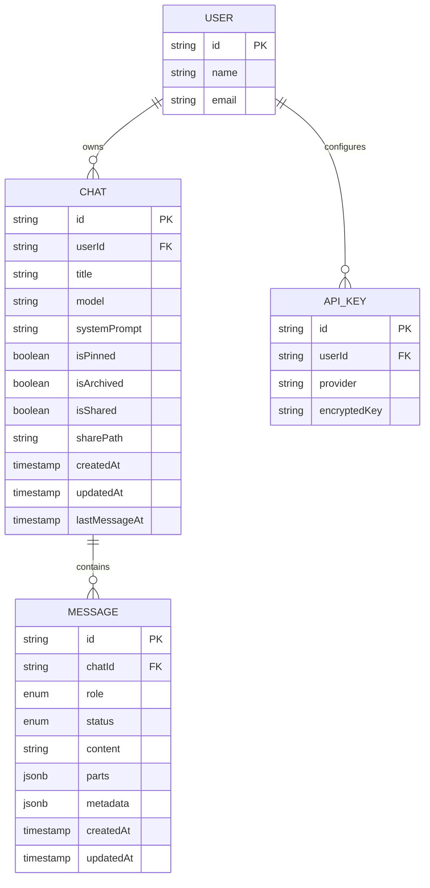

# Mentis AI - Database Design

This document outlines the database schema design for Mentis AI, heavily optimized for PostgreSQL and Drizzle ORM. 

## 1. Design Philosophy & Efficiency Thoughts

Before designing the tables, several architectural decisions were made to ensure high performance and scalability:

1.  **Read-Optimized Chat Listing:** Fetching a user's chat history is the most frequent query after authentication. We need compound indexes on `(userId, lastMessageAt DESC)` to ensure O(1) or O(log N) fetching of chat sidebars.
2.  **Insert-Optimized Messages:** AI applications are write-heavy (streaming message chunks, saving tool calls). The `message` table must have minimal indexes (only what's necessary for fetching a chat's history) to prevent B-Tree fragmentation and keep inserts lightning fast.
3.  **Time-Sortable Primary Keys:** Instead of standard UUIDv4 (which causes B-Tree fragmentation due to randomness), we should use **ULIDs or CUID2s** for primary keys. They are lexicographically sortable by time, making database inserts sequential and significantly improving page cache hits.
4.  **Handling "Branching":** The PRD requires "Branch chats from a specific message." Implementing this as a tree structure inside a single chat (like a Git tree) requires complex Recursive CTE queries to fetch a single conversation thread. A more efficient approach for reads is **Copy-on-Branch**: when a user branches, we create a new `chat` and duplicate the `message` rows up to that point. Storage is cheap; CPU time on recursive reads is expensive.
5.  **Future-Proof Message Content:** The Vercel AI SDK (especially version 3.0+) heavily uses structured content (arrays of text/images, tool calls, and tool results). We store the string representation in `content` and use `parts` and `metadata` (as `jsonb`) for advanced multi-modal or tool structures without schema migrations later. We also track message `status` (pending, complete, error) which is useful for streaming UI states.

## 2. Entity Relationship Diagram (ERD)



## 3. Drizzle Schema Definitions

The existing authentication schema (Better Auth) resides in `user`, `session`, `account`, and `verification`. 
The following schemas should be added for the application logic:

### 3.1 Chat Schema

Stores the top-level conversation metadata.

```typescript
import { pgTable, text, timestamp, boolean, index, uniqueIndex } from "drizzle-orm/pg-core";
import { user } from "./auth-schema"; // from existing better-auth schema

export const chat = pgTable(
  "chat",
  {
    id: text("id").primaryKey(), // ULID or CUID2
    userId: text("user_id")
      .notNull()
      .references(() => user.id, { onDelete: "cascade" }),
    title: text("title").notNull().default("New Chat"),
    model: text("model"), // e.g. openai/gpt-4o — per-thread model override
    systemPrompt: text("system_prompt"),
    isPinned: boolean("is_pinned").default(false).notNull(),
    isArchived: boolean("is_archived").default(false).notNull(),
    isShared: boolean("is_shared").default(false).notNull(),
    sharePath: text("share_path").unique(), // For public sharing links
    createdAt: timestamp("created_at").defaultNow().notNull(),
    updatedAt: timestamp("updated_at")
      .defaultNow()
      .$onUpdate(() => new Date())
      .notNull(),
    lastMessageAt: timestamp("last_message_at").defaultNow().notNull(),
  },
  (table) => [
    // Highly efficient index for rendering the sidebar (filtering by user, sorting by latest)
    index("chat_userId_lastMessageAt_idx").on(table.userId, table.lastMessageAt.desc()),
    // Index for filtering pinned or archived chats efficiently
    index("chat_userId_isPinned_lastMessageAt_idx").on(table.userId, table.isPinned, table.lastMessageAt.desc()),
  ]
);
```

### 3.2 Message Schema

Stores individual messages (User, Assistant, System, Tool/Data). 

```typescript
import { pgTable, text, timestamp, jsonb, index, pgEnum } from "drizzle-orm/pg-core";
import { chat } from "./chat-schema";

export const roleEnum = pgEnum("role", ["system", "user", "assistant", "data", "tool"]);
export const messageStatusEnum = pgEnum("status", ["pending", "complete", "error"]);

export const message = pgTable(
  "message",
  {
    id: text("id").primaryKey(),
    chatId: text("chat_id")
      .notNull()
      .references(() => chat.id, { onDelete: "cascade" }),
    role: roleEnum("role").notNull(),
    status: messageStatusEnum("status").default("complete").notNull(),
    content: text("content").notNull(),
    parts: jsonb("parts"),
    metadata: jsonb("metadata"),
    createdAt: timestamp("created_at").defaultNow().notNull(),
    updatedAt: timestamp("updated_at")
      .defaultNow()
      .$onUpdate(() => new Date())
      .notNull(),
  },
  (table) => [
    // Essential for loading a chat's history chronologically
    index("message_chatId_createdAt_idx").on(table.chatId, table.createdAt.asc()),
  ]
);
```

### 3.3 User API Keys Schema

Stores user-provided API keys. Keys MUST be encrypted at the application layer before reaching the DB.

```typescript
import { pgTable, text, timestamp, uniqueIndex } from "drizzle-orm/pg-core";
import { user } from "./auth-schema";

export const apiKey = pgTable(
  "api_key",
  {
    id: text("id").primaryKey(),
    userId: text("user_id")
      .notNull()
      .references(() => user.id, { onDelete: "cascade" }),
    provider: text("provider").notNull(), // 'openai', 'anthropic', 'gemini'
    encryptedKey: text("encrypted_key").notNull(),
    createdAt: timestamp("created_at").defaultNow().notNull(),
    updatedAt: timestamp("updated_at")
      .defaultNow()
      .$onUpdate(() => new Date())
      .notNull(),
  },
  (table) => [
    // Ensure a user can only have one key per provider
    uniqueIndex("api_key_userId_provider_idx").on(table.userId, table.provider),
  ]
);
```

## 4. Key Takeaways for the Implementation Phase

1. **Generation of IDs**: Use a package like `ulid` or `@paralleldrive/cuid2` for generating the IDs before inserting into the DB. This prevents database bottlenecks on insert.
2. **Encryption**: The `encryptedKey` field must be encrypted using standard AES-256-GCM using an environment variable secret (e.g., `ENCRYPTION_KEY`) before saving.
3. **Optimistic Updates**: Since we use sequential IDs and fast compound indexes, the frontend (TanStack Query) can easily perform optimistic UI updates for chat creation and message appending, ensuring the UI feels instant.
